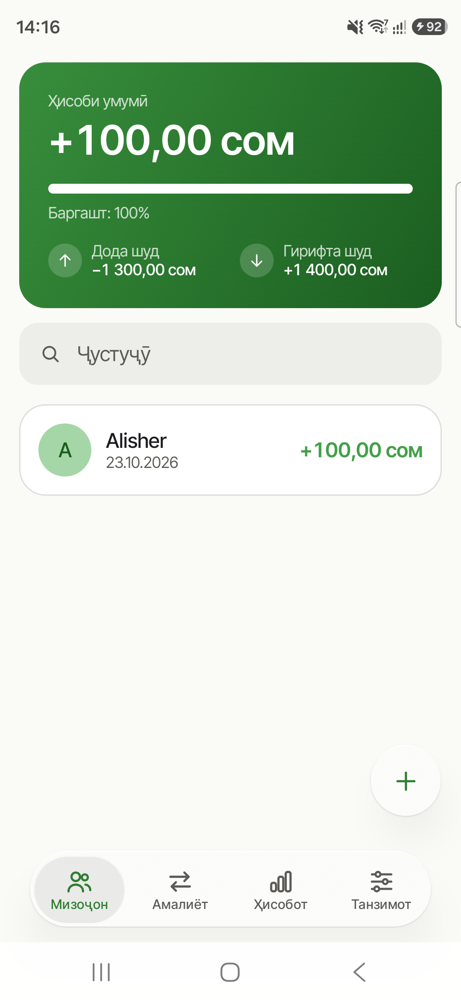
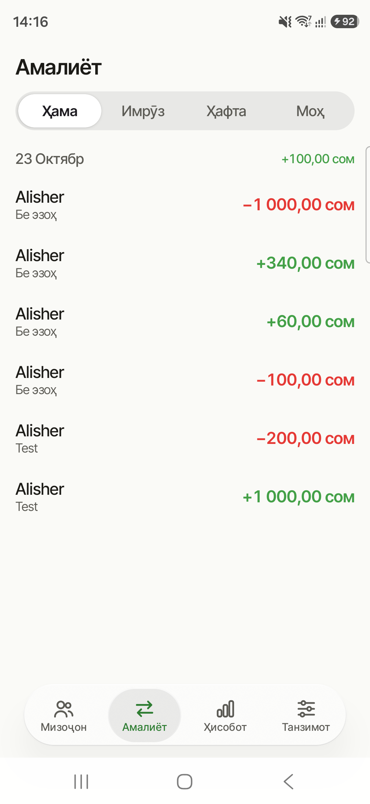
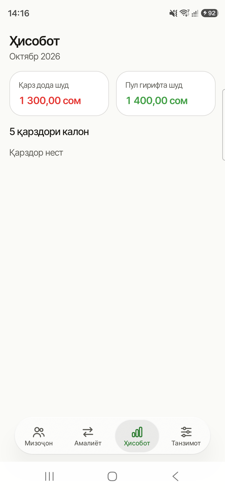
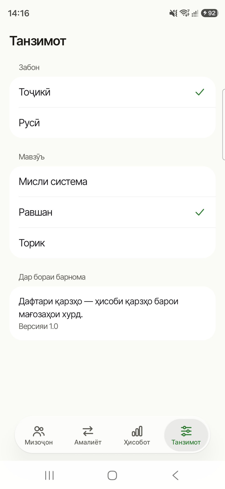
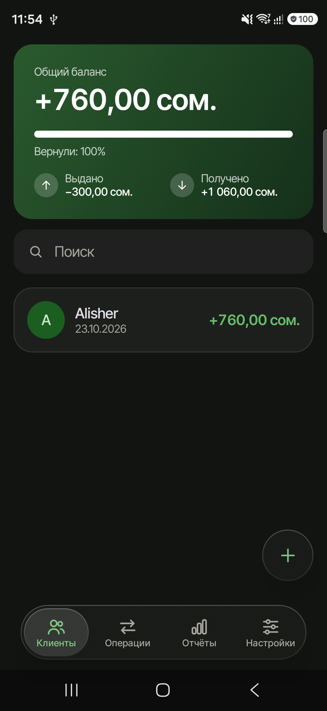
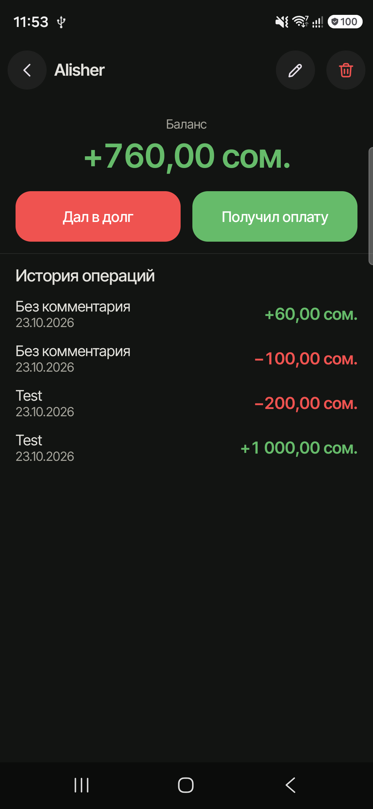
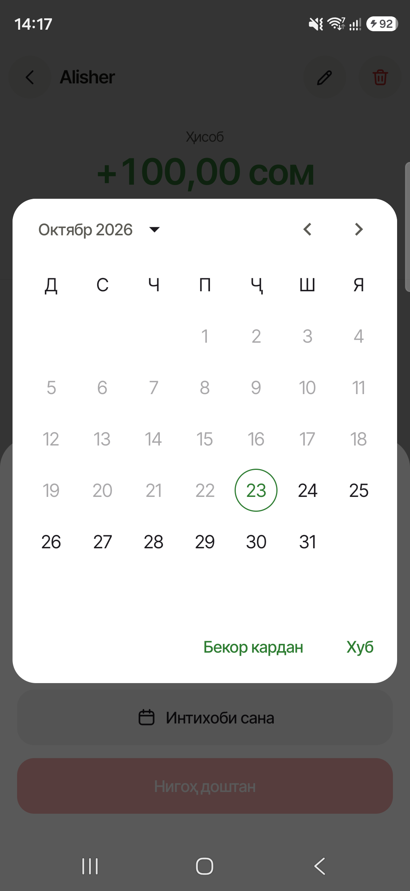

<div align="center">


# Дафтари қарзҳо

**Простой офлайн-учёт долгов для небольших магазинов**

Кто сколько взял, кто сколько вернул и у кого истёк срок — в одном приложении, без интернета и регистрации.

[](LICENSE)


**Русский** · [English](README.en.md)

[Возможности](#возможности) · [Скриншоты](#скриншоты) · [Сборка](#сборка-и-запуск) · [Архитектура](#архитектура) · [Как помочь](#как-помочь-проекту) · [Лицензия](#лицензия)

</div>

---

## О проекте

В маленьких магазинах долги часто записывают в бумажную тетрадь — «дафтар». **Дафтари қарзҳо** — это та же тетрадь, только в телефоне: она сама считает баланс каждого клиента, показывает общую сумму и напоминает о просроченных долгах.

- **Полностью офлайн.** У приложения нет разрешения на интернет, все данные хранятся только на телефоне.
- **Без аккаунтов.** Установил — и пользуешься.
- **Два языка.** Таджикский (по умолчанию) и русский.
- **Открытый код.** Проект распространяется под лицензией Apache 2.0 — его можно изучать, менять и использовать в своих проектах.

> **Тоҷикӣ.** «Дафтари қарзҳо» — барномаи офлайн барои ҳисоби қарзҳо дар мағозаҳои хурд. Бе интернет, бе қайд кардан, бо забонҳои тоҷикӣ ва русӣ. Коди барнома кушода аст.

## Возможности

| | |
|---|---|
| 👥 **Клиенты** | Список с поиском, баланс и дата последней операции у каждого |
| 💸 **Долги и оплаты** | «Дал в долг» и «Получил оплату» в два касания, комментарий и срок возврата |
| ⏰ **Просрочка** | Отметка, сколько дней просрочен долг |
| 📊 **Сводка** | Общий баланс, сколько выдано и получено, полоска «сколько уже вернули» |
| 🗓️ **Лента операций** | Все операции по дням с фильтром «Сегодня / Неделя / Месяц» |
| 📈 **Отчёт за месяц** | Выдано, получено и топ-5 должников |
| 🎨 **Оформление** | Светлая и тёмная тема, меню и кнопки в стиле «жидкого стекла», свои иконки |
| 🌐 **Языки** | Таджикский и русский, переключаются прямо в приложении |

## Скриншоты

<div align="center">

| Главный экран | Операции | Отчёт | Настройки |
|:---:|:---:|:---:|:---:|
|  |  |  |  |

| Тёмная тема | Карточка клиента | Срок возврата |
|:---:|:---:|:---:|
|  |  |  |

</div>

## Сборка и запуск

**Нужно:**

- Android Studio (последняя стабильная версия) или JDK 17+
- Android SDK с платформой 36
- Телефон или эмулятор с Android 7.0 (API 24) и новее

**Шаги:**

```bash
git clone https://github.com/UMARJO9/Daftari-Qarzho-App.git
cd Daftari-Qarzho-App
./gradlew assembleDebug
```

Готовый APK появится в `app/build/outputs/apk/debug/`. Чтобы сразу поставить его на подключённый телефон:

```bash
./gradlew installDebug
```

Или просто откройте папку проекта в Android Studio и нажмите **Run**.

**Тесты:**

```bash
./gradlew testDebugUnitTest
```

## Технологии

| Что | Чем |
|---|---|
| Язык | Kotlin, Coroutines + Flow |
| Интерфейс | Jetpack Compose, Material 3, собственный UI kit |
| Эффект стекла | [Haze](https://github.com/chrisbanes/haze) |
| Хранение | Room (операции и клиенты), DataStore (настройки) |
| Внедрение зависимостей | Koin |
| Навигация | Navigation Compose с type-safe маршрутами |
| Языки | Per-app locale через AppCompat |
| Сборка | AGP 9, Gradle Kotlin DSL, version catalog |
| Тесты | JUnit 4, kotlinx-coroutines-test, Turbine, рукописные фейки |

## Архитектура

Проект многомодульный, внутри каждой фичи — Clean Architecture (`presentation → domain ← data`).

```
app                     точка входа: тема, навигация, главный экран с вкладками
core/common             деньги и даты: MoneyFormatter, DateFormatter
core/database           Room: таблицы, DAO, база данных
core/designsystem       тема DaftarTheme, UI kit, иконки
feature/debtors         клиенты, карточка клиента, долги и оплаты
feature/transactions    лента операций
feature/reports         отчёт за месяц
feature/settings        язык, тема, «О приложении»
```

**Правила, которых держится код:**

- Фичи не зависят друг от друга — их связывает только модуль `app`.
- Деньги хранятся как `Long` в дирамах (1 сомони = 100 дирам), без `Double` и `Float`.
- Каждый экран — это `UiState` + `Event` + `ViewModel`, которая получает только use case'ы.
- Бизнес-логика живёт в use case'ах и покрыта unit-тестами на фейках.

## Как помочь проекту

Будем рады любой помощи: исправлениям, новым функциям, переводам и идеям.

1. Сделайте fork и создайте ветку от `dev`.
2. Внесите изменения и проверьте, что проходят сборка и тесты: `./gradlew build`.
3. Откройте pull request в ветку `dev` с понятным описанием.

**Договорённости:**

- Сообщения коммитов — на русском в формате [Conventional Commits](https://www.conventionalcommits.org/ru/): `feat(debtors): ...`, `fix(reports): ...`.
- Комментарии в коде не пишем — код должен объясняться именами.
- Новые строки интерфейса добавляются сразу на двух языках: `values/` и его копия `values-tg/` (таджикский), `values-ru/` (русский).
- Нашли ошибку или есть идея — создайте [issue](https://github.com/UMARJO9/Daftari-Qarzho-App/issues).

## Лицензия

Проект распространяется под лицензией **Apache License 2.0** — подробности в файле [LICENSE](LICENSE).

Copyright © 2026 [UMARJO9](https://github.com/UMARJO9)
